# GamePort

**Tes jeux Steam Frame sur ton Quest, ton Pico ou n'importe quel appareil Android.**

GamePort est une appli gratuite et open source. Elle se connecte à ton compte Steam, affiche les versions Android des jeux que tu possèdes (et de ceux partagés par ta famille Steam), puis s'occupe de tout : téléchargement, installation, lancement. Tes sauvegardes te suivent grâce au cloud Steam, et ton temps de jeu compte sur ton compte.

  

> GamePort est un projet communautaire indépendant. Il n'est ni créé par Valve, Meta ou Pico, ni affilié à eux.

## Un aperçu

<table>
<tr><td width="50%">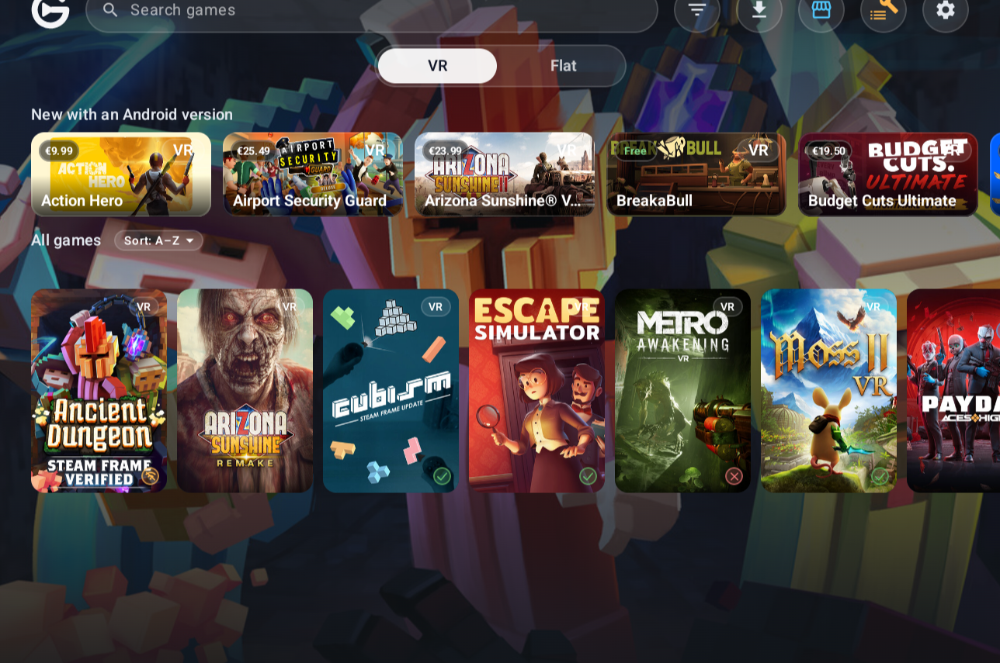</td><td width="50%">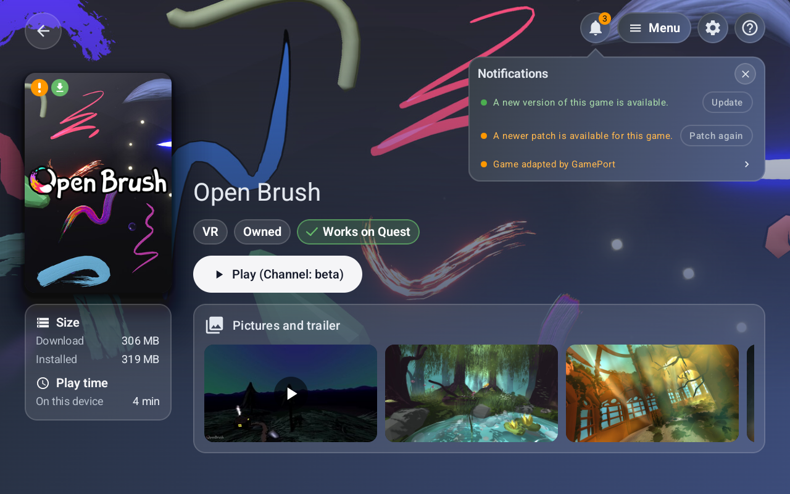</td></tr>
<tr><td align="center">L'accueil : les nouvelles versions Android avec leur prix, puis tes jeux</td><td align="center">Un jeu de ta bibliothèque</td></tr>
</table>

## Le store : les versions Android des jeux Steam

Tous les jeux Steam qui ont une version Android, au même endroit, avec ce qu'il faut pour se décider.

- **Le prix, dans ta monnaie.** Celle dans laquelle ton compte Steam est facturé, avec le pourcentage de remise en promotion. Le bouton ouvre la page Steam : GamePort ne vend rien.
- **Son historique de prix.** Le prix le plus bas relevé, la dernière promotion et un verdict simple, de « Au plus bas » à « Mieux vaut attendre », pour savoir si ça vaut le coup maintenant.
- **Ce que disent les joueurs sur ton appareil**, et les verdicts de Valve pour la Steam Frame et le Steam Deck, à côté des langues (texte, voix, sous-titres) comme Steam les montre.
- **Des filtres qui tiennent sur deux lignes.** VR ou plat, installable ou à venir, possédé ou non, compatible ou non ; puis les langues et les genres, et huit façons de trier : nom, note, sortie, prix, remise.
- **Une rangée des jeux en promotion que tu ne possèdes pas**, et les nouvelles versions Android de la semaine sur l'accueil.

<table>
<tr><td width="50%">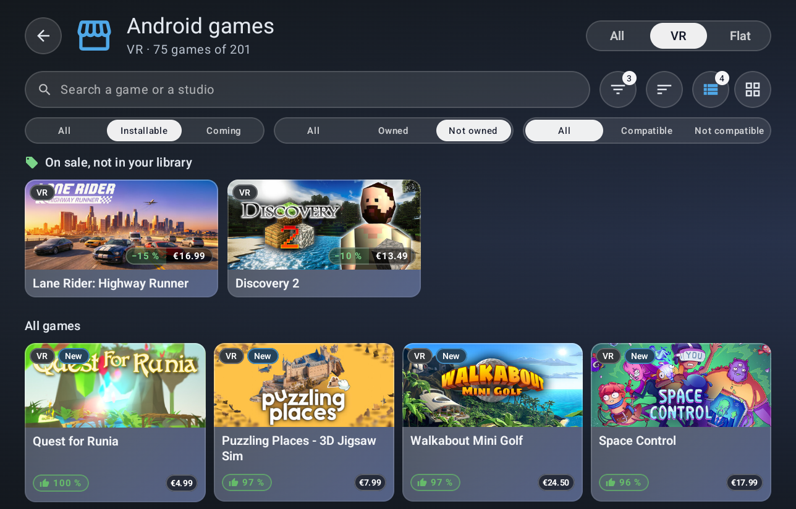</td><td width="50%">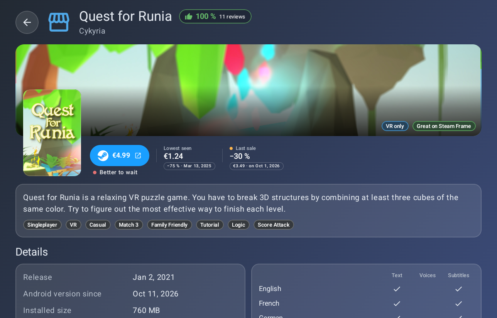</td></tr>
<tr><td align="center">La liste, avec les jeux en promotion</td><td align="center">Un jeu : prix, historique et verdict</td></tr>
</table>

## Compatibilité, rapportée par les joueurs

Les joueurs disent si chaque jeu marche sur leur type d'appareil (marche, hors ligne seulement, problèmes). Le tableau le montre jeu par jeu et appareil par appareil, et la même pastille est sur les jaquettes du store.

<table>
<tr><td width="50%">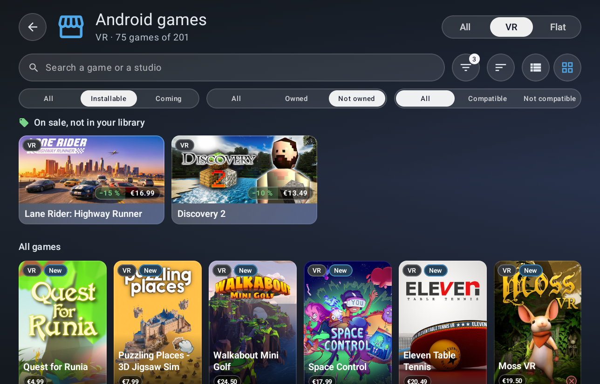</td><td width="50%">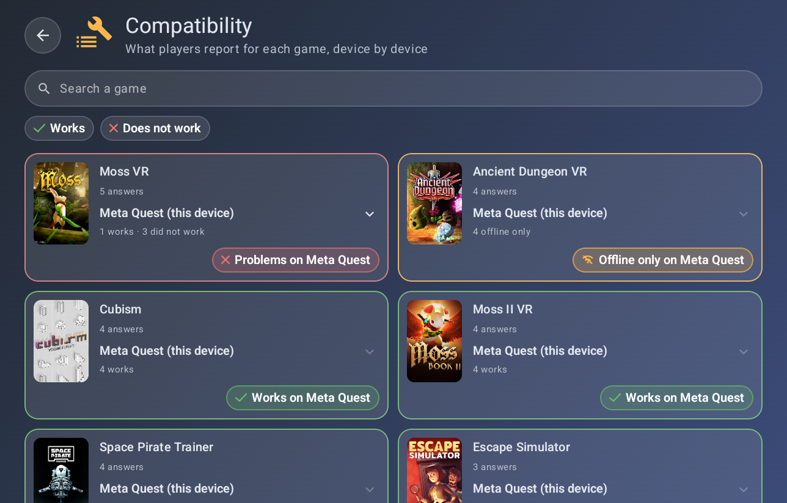</td></tr>
<tr><td align="center">La liste en jaquettes</td><td align="center">Le tableau de compatibilité</td></tr>
</table>

Plus d'écrans

  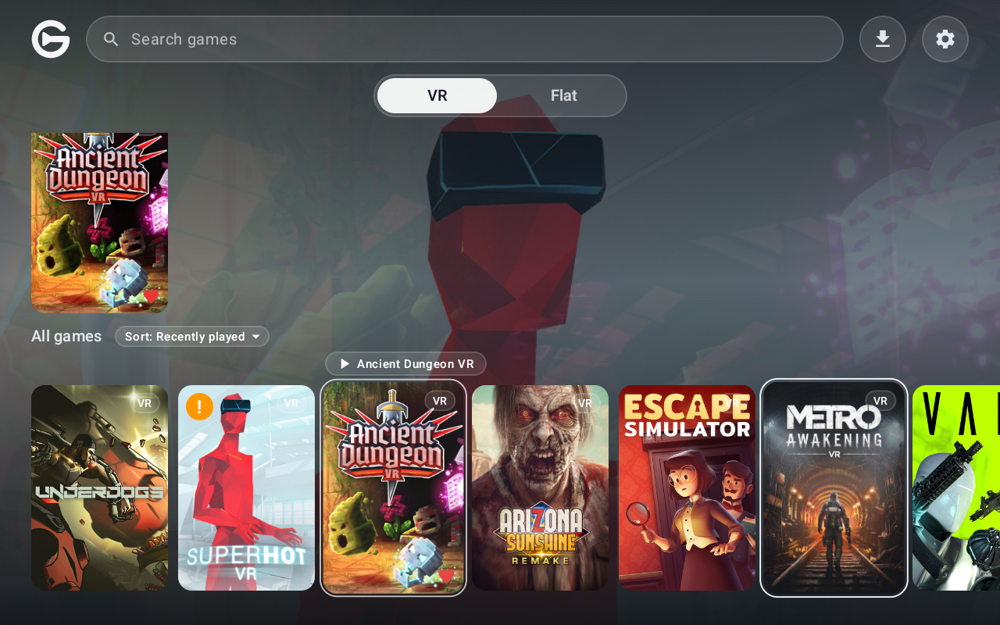
  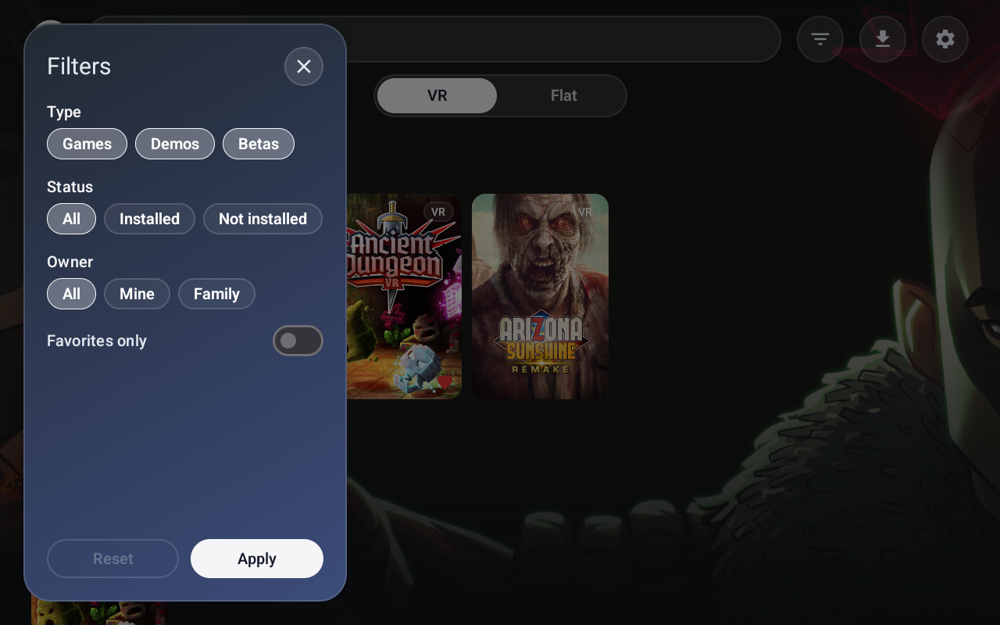

  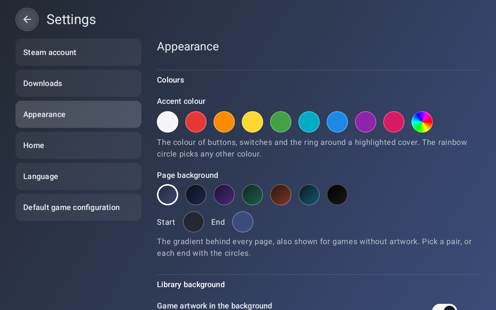
  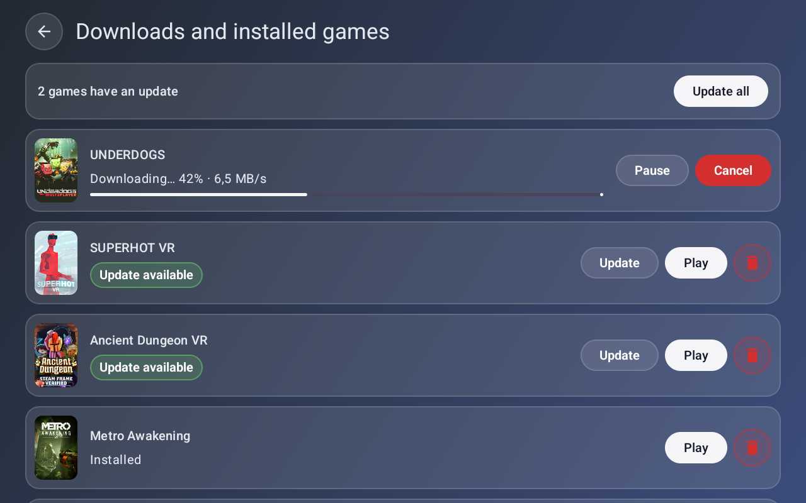

  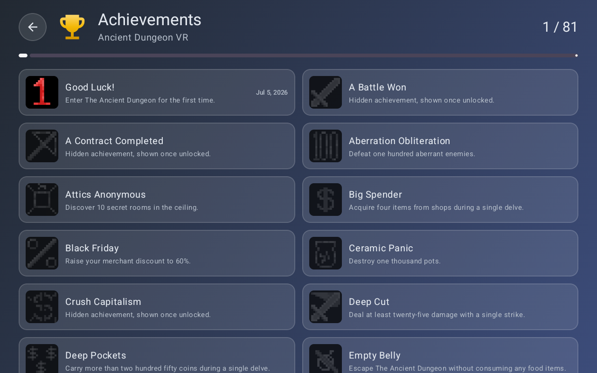

  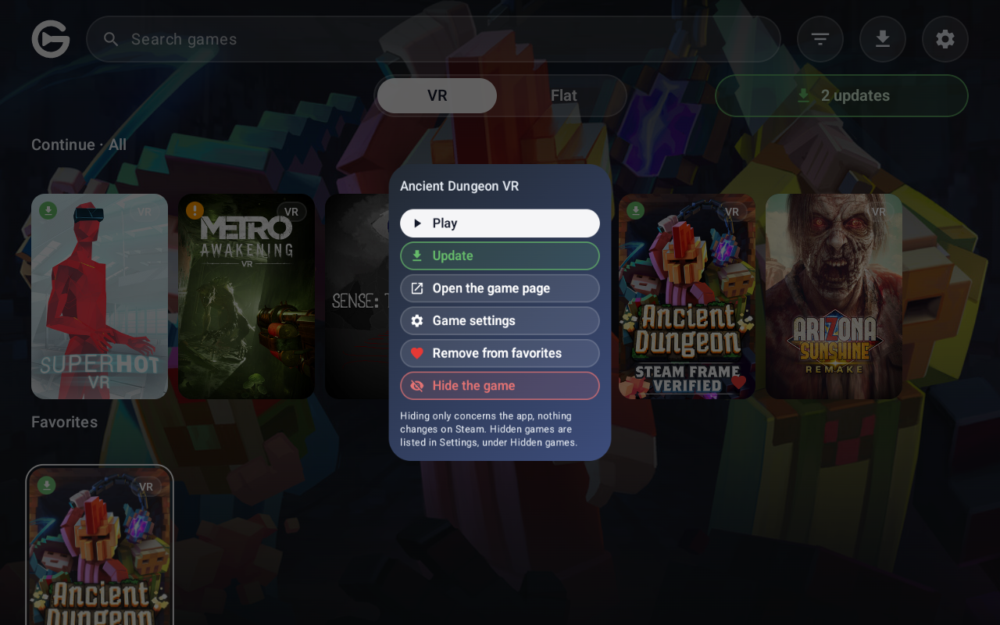
  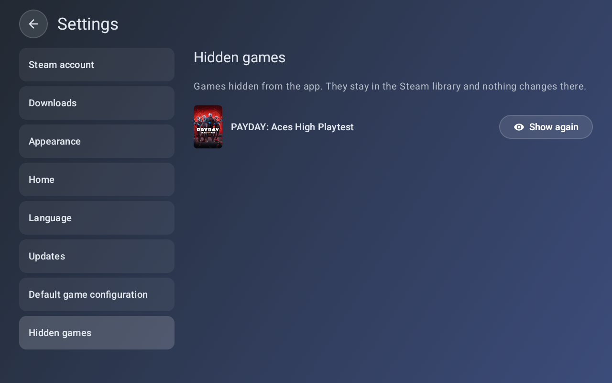

  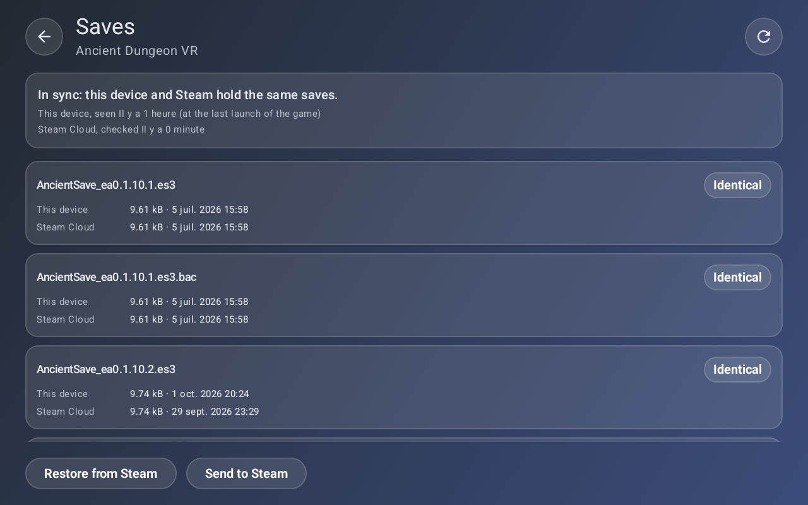
  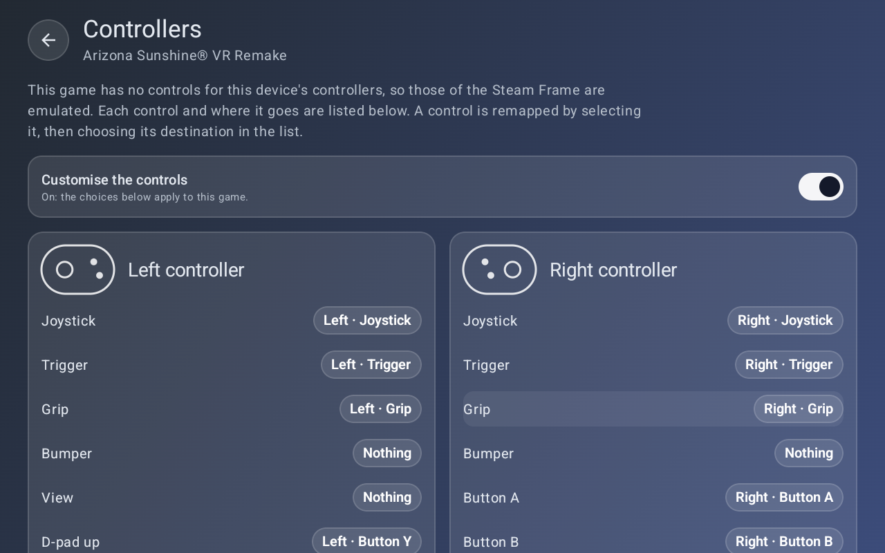

## Ce qu'elle fait

- **Ta bibliothèque, bien rangée.** Jeux VR et plats, démos et bêtas, recherche, filtres, favoris, une rangée « Continuer » avec les derniers jeux lancés, et une apparence à ton goût : taille des covers, couleurs, fond, langue.
- **Un store pour les versions Android.** Tous les jeux Steam qui en ont une, avec leur prix, l'historique de leur prix et ce que les joueurs en disent sur ton appareil. Voir [le store](#le-store--les-versions-android-des-jeux-steam).
- **Une pression pour installer.** GamePort télécharge le jeu, le prépare pour qu'il tourne sur ton appareil et l'installe. Elle te prévient quand un jeu a une nouvelle version.
- **Ton compte Steam, tes sauvegardes.** Les jeux tournent sous ton propre compte. Les sauvegardes restent synchronisées avec le cloud Steam, et une page par jeu permet de choisir quoi restaurer ou envoyer.
- **Un temps de jeu qui compte.** Le temps passé s'ajoute à ton compte Steam, et seulement quand le jeu est réellement à l'écran : pas quand l'appareil est en veille.
- **Tes manettes, à ta façon.** Les jeux conçus pour les manettes de la Steam Frame sont traduits sur les tiennes, et le mappage se change jeu par jeu.
- **Pensée pour les casques, sympa sur téléphone et tablette.** Sur un téléphone ou une tablette, tout ce qui touche à la VR disparaît simplement.

## Fonctionne sur

- Meta Quest (2, 3, 3S, Pro)
- Pico (4, 4 Ultra et d'autres)
- D'autres casques Android, tant qu'ils font tourner des jeux OpenXR
- Téléphones et tablettes Android, pour les jeux qui ne sont pas en VR

## Pour commencer

1. Télécharge le dernier APK sur la [page des versions](https://github.com/gameport-project/gameport-app/releases/latest) et installe-le sur ton appareil (installation manuelle).
2. Ouvre-la et scanne le QR code avec l'appli Steam de ton téléphone pour te connecter. Ton mot de passe ne passe jamais par GamePort.
3. Choisis un jeu dans ta bibliothèque et appuie sur **Installer**.
4. Appuie sur **Jouer**.

La première fois qu'un jeu a besoin d'une permission, GamePort explique pourquoi avant de la demander.

## Bon à savoir

- **Chaque jeu est une aventure.** Ces jeux n'ont pas été pensés pour ton appareil, GamePort les teste donc un par un. La liste de ce qui marche, de ce qui ne marche pas et pourquoi est dans [docs/COMPATIBILITY_TESTING.md](docs/COMPATIBILITY_TESTING.md).
- **Les fonctions en ligne peuvent ne pas marcher** dans certains jeux. Le solo et les sauvegardes sont la priorité aujourd'hui.
- **Un seul jeu à la fois par compte Steam.** Steam n'autorise qu'une partie à la fois sur un compte : lancer un jeu sur ton casque met en pause celui qui tourne sur ton PC. Tu peux couper le comptage du temps de jeu dans les réglages si tu préfères.
- **Il faut posséder le jeu.** GamePort n'installe que les jeux de ton compte ou partagés par ta famille Steam. Le store liste les autres, avec un lien vers Steam.
- **Les prix sont un repère.** Ils viennent des données publiques de Steam, dans la monnaie de ton compte, et l'historique d'un service d'historique de prix ; la page Steam a le dernier mot.

## Quand un jeu ne marche pas

Ouvre la page du jeu et appuie sur le bouton bug, ou sur **Signaler un problème** qui apparaît quand une installation échoue. GamePort le signale aussi pour un jeu qui s'est fermé tout de suite ou qui a planté.

- **Enregistre le rapport.** Il crée un zip dans le dossier Téléchargements de ton appareil. Il contient les versions, l'appareil, les fichiers du jeu, son journal et celui de GamePort, la façon dont ses dernières exécutions se sont terminées, et ce que GamePort a fait pour lui.
- **GamePort n'envoie rien.** Tu choisis quoi faire du fichier : le joindre à un [ticket](https://github.com/gameport-project/gameport-app/issues/new?template=game-problem.md), ou l'envoyer aux développeurs par n'importe quel moyen.
- **Ton identité reste dehors.** Les numéros de compte, les adresses e-mail, les adresses réseau et le nom de ton compte sont retirés des fichiers texte. Le rapport de plantage gardé par Android, quand il y en a un, est un fichier binaire et n'est pas filtré.
- **Il fait le ménage.** Ce que GamePort garde pour les rapports est supprimé après une semaine, et quand le jeu est désinstallé. Les zips que tu as enregistrés t'appartiennent et ne sont jamais touchés.

## Rejoindre la communauté

Un endroit sympa pour demander de l'aide, dire quels jeux tournent bien sur ton appareil, suivre les nouvelles versions et proposer des idées. GamePort y côtoie les plugins Decky et les autres petits projets du même auteur.

[**Rejoindre le Discord**](https://discord.gg/yWXXAC2AKc) · questions, rapports de bug, compatibilité, nouvelles versions

## Ta vie privée

- Ta connexion reste sur ton appareil. Elle n'est envoyée qu'à Steam.
- GamePort n'affiche aucune publicité qui te suit et ne collecte rien sur toi.
- Pour montrer les versions Android et les prix, GamePort lit des fichiers publics d'un dépôt GitHub (environ toutes les trois heures, et seulement ce qui a changé). Elle n'envoie rien sur toi : GitHub voit ton adresse IP comme pour n'importe quelle page web. La monnaie de ton compte Steam, qui choisit les prix, reste sur ton appareil.
- À son ouverture, GamePort peut consulter la page de la dernière version sur GitHub pour te dire qu'une version plus récente existe (toutes les 4 heures par défaut ; le délai, ou Jamais, est un réglage). Il ne fait que regarder : rien n'est téléchargé ni installé sans un appui, et GitHub voit ton adresse IP comme pour n'importe quelle page web.
- Elle est gratuite et le restera : pas d'appli payante, pas de mur payant.

## Open source

GamePort se construit au grand jour, avec l'aide d'autres projets libres : une couche d'émulation de Steam basée sur le [Goldberg Steam Emulator](https://gitlab.com/Mr_Goldberg/goldberg_emulator), des idées et du code d'[ovrport](https://github.com/ovrport/app), et [JavaSteam](https://github.com/Longi94/JavaSteam) pour parler à Steam. Tout ce que nous réutilisons, avec sa licence, est listé dans [docs/THIRD_PARTY_NOTICES.md](docs/THIRD_PARTY_NOTICES.md).

- Les prix passés des jeux viennent d'[IsThereAnyDeal](https://isthereanydeal.com), lus une fois pour chaque jeu puis gardés dans [gameport-catalog](https://github.com/gameport-project/gameport-catalog), qui contient aussi le catalogue et les ports VR de la communauté.
- La partie qui simule Steam dans les jeux vit dans son propre dépôt : **gameport-steamworks-shim**.
- Envie de le compiler toi-même ou de donner un coup de main ? Voir [docs/DEVELOPMENT.md](docs/DEVELOPMENT.md).

English: [README.md](README.md)
