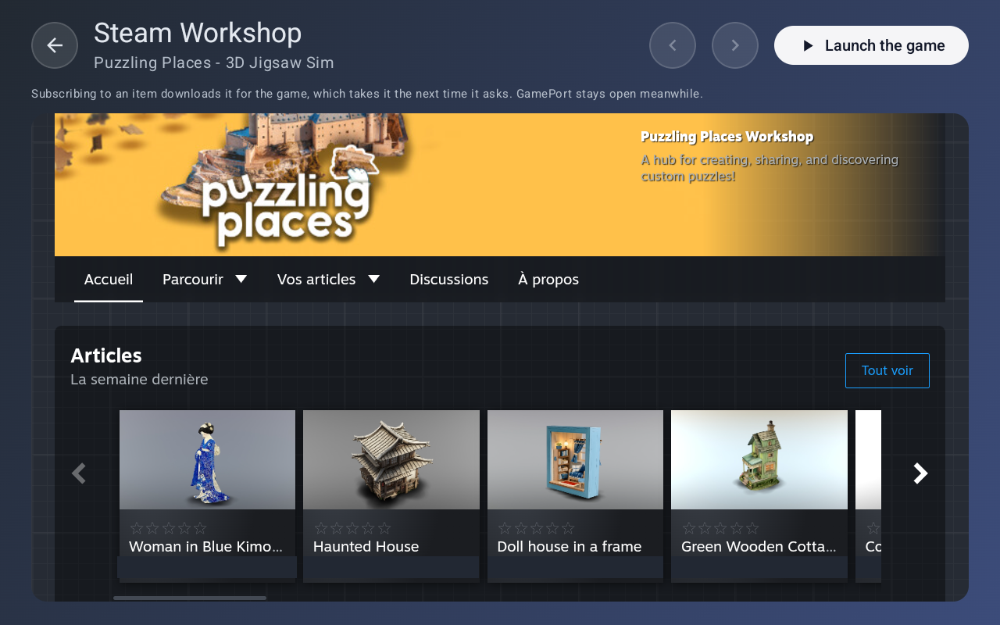
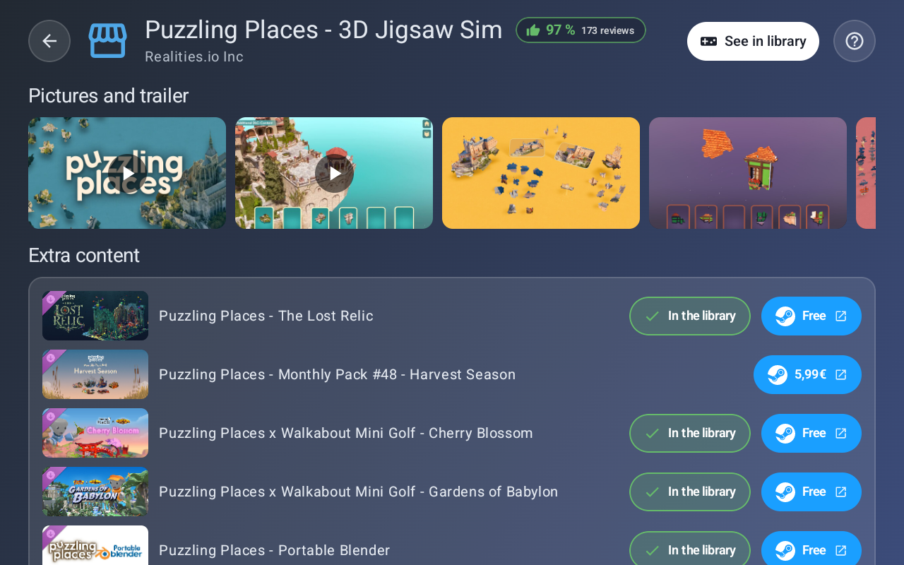
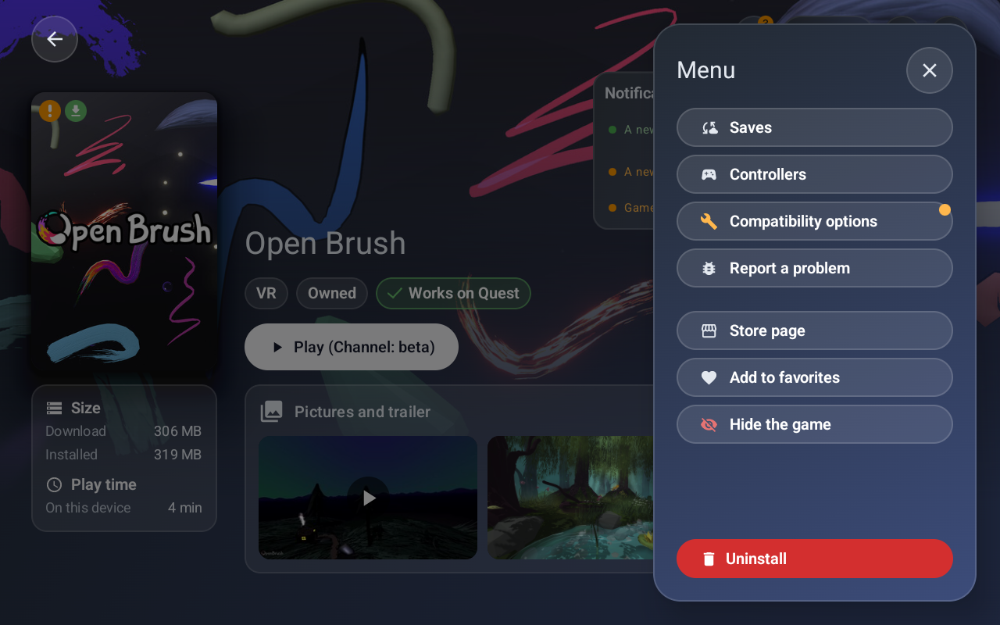

## GamePort 0.9.2

### What's new in this version

#### New features
- **Update channels.** A game's settings list the channels of Steam that hold an Android version, and the game can follow one. A game that is only on a test channel is listed too, and its play button names the channel.
- **The library updates itself.** While GamePort is open, it checks every ten minutes for new games and for a game that gets an Android version. A button in Settings checks right away.
- **Workshop and extra content.** GamePort downloads the account's Workshop items and extra content, and hands them to the game.
- **The Steam Workshop inside GamePort.** The Workshop of a game opens in the application, already signed in with the account: no new sign-in. A button at the top leads back to the game without leaving GamePort, and the game's own "Browse" button opens the Workshop there instead of the browser. What the account subscribes to is downloaded for the game.

  
- **A new page for each game.** A bell gathers what wants a look (a new version, a newer patch, saves that do not match Steam, a game GamePort adapted), each with its button. An install is one card with its steps, the game and every extra content it will fetch, and the same card shows a patch. The pictures and the trailer of the game are on its page. Play just plays, and asks what to do first when a new version or a newer patch is waiting. The page fits a phone too.

  
- **Extra content in the store.** The page of a game lists its extra content with its picture and its price. A free one can be added to the library with a button, the ones the account already has say so, and each Steam button opens inside GamePort.

  
- **Pictures and trailer on a game's page.** The screenshots and the trailer of a game are on its page, in the library as in the store.
- **A link to the store page.** The menu of a game opens its page in the store, and the Steam buttons of the store open inside GamePort.
- **Every action of a game in one menu.** Saves, Workshop, controllers, compatibility options, reporting a problem, the game's page in the store, favorite, hide, and uninstall are in the Menu, which opens like the filters.

  
- **Saves shared with the PC.** The saves page of a game can send its Android saves to the PC saves in Steam Cloud, after keeping a clean copy of those, and put them back.
- **Better on a Pico:** controls, controller extension, swapchain and OpenXR loader.
- **Store:** a "Not tested yet" filter and alerts that say what the filters hide.
- **More memory for a game.** A setting asks the apps the player installed and that run in the background to close before a game starts, and a short alert says how much memory that gave back.
- **A problem report that says more.** It says where an installation waited, what the game was doing just after its start, and whether its online servers could be reached.

#### Fixes
- Expansion files are no longer lost when a game is installed over.
- A demo and its game that share a package are one installed game.
- A game is no longer closed when GamePort stops.
- Games are patched again when moving between an alpha and the release.
- A game that uses the eye-following foveation no longer crashes a device without eye tracking. A choice in the game's compatibility page changes it.
- The passthrough works for more games: the project keeps a list of the games that need it, and adds one without a new version.
- The saves of a game whose Steam path starts from Android/data (Cubism) are read and sent again.

---

### Install
The APK is `GamePort-v0.9.2.apk`, below. GamePort 0.9.1 offers it by itself, in Settings > Updates. On a Quest, developer mode is needed, with SideQuest or `adb install GamePort-v0.9.2.apk`. On a phone or a tablet, opening the file is enough.

It installs over 0.9.1 and keeps games, saves and settings. Games patched by an earlier version show an attention point, and GamePort offers to patch them again when it first opens.

GamePort is free and open source, and is not made by or affiliated with Valve, Meta or Pico. See the [README](https://github.com/gameport-project/gameport-app#readme).

---

## GamePort 0.9.2

### Les nouveautés de cette version

#### Nouvelles fonctionnalités
- **Canaux de mise à jour.** Les réglages d'un jeu listent les canaux de Steam qui ont une version Android, et le jeu peut en suivre un. Un jeu qui n'est que sur un canal de test est listé aussi, et son bouton jouer nomme le canal.
- **La bibliothèque se met à jour toute seule.** Quand GamePort est ouvert, il vérifie toutes les dix minutes s'il y a de nouveaux jeux ou un jeu qui reçoit une version Android. Un bouton des réglages vérifie tout de suite.
- **Atelier et contenus additionnels.** GamePort télécharge les objets de l'atelier et les contenus additionnels du compte, et les remet au jeu.
- **L'atelier Steam dans GamePort.** L'atelier d'un jeu s'ouvre dans l'application, déjà connecté avec le compte : pas de nouvelle connexion. Un bouton en haut ramène au jeu sans quitter GamePort, et le bouton « Parcourir » du jeu ouvre l'atelier à cet endroit au lieu du navigateur. Ce à quoi le compte s'abonne est téléchargé pour le jeu.

  
- **Une nouvelle page pour chaque jeu.** Une cloche réunit ce qui demande un coup d'œil (une nouvelle version, un patch plus récent, des sauvegardes qui ne correspondent pas à Steam, un jeu que GamePort a adapté), chacun avec son bouton. Une installation tient dans une seule carte avec ses étapes, le jeu et chaque contenu additionnel qu'elle va chercher, et la même carte montre un patch. Les images et la bande-annonce du jeu sont sur sa page. Jouer lance simplement le jeu, et demande quoi faire d'abord quand une nouvelle version ou un patch plus récent attend. La page convient aussi à un téléphone.

  
- **Les contenus additionnels dans le store.** La page d'un jeu liste ses contenus additionnels avec leur image et leur prix. Un contenu gratuit s'ajoute à la bibliothèque avec un bouton, ceux que le compte possède déjà le disent, et chaque bouton Steam s'ouvre dans GamePort.

  
- **Les images et la bande-annonce sur la page d'un jeu.** Les captures et la bande-annonce d'un jeu sont sur sa page, dans la bibliothèque comme dans le store.
- **Un lien vers la page du store.** Le menu d'un jeu ouvre sa page dans le store, et les boutons Steam du store s'ouvrent dans GamePort.
- **Toutes les actions d'un jeu dans un seul menu.** Sauvegardes, atelier, manettes, options de compatibilité, signalement d'un problème, page du jeu dans le magasin, favori, masquer et désinstaller sont dans le Menu, qui s'ouvre comme les filtres.

  
- **Sauvegardes partagées avec le PC.** La page des sauvegardes d'un jeu peut envoyer ses sauvegardes Android vers les sauvegardes PC de Steam Cloud, après en avoir gardé une copie propre, et les remettre en place.
- **Mieux sur un Pico :** commandes, extension des manettes, swapchain et chargeur OpenXR.
- **Magasin :** un filtre « Pas encore testé » et des alertes qui disent ce que les filtres cachent.
- **Plus de mémoire pour un jeu.** Un réglage demande aux applications installées par le joueur qui tournent en arrière-plan de se fermer avant qu'un jeu démarre, et une courte alerte dit combien de mémoire cela a rendue.
- **Un rapport de problème qui en dit plus.** Il dit où une installation a attendu, ce que faisait le jeu juste après son démarrage, et si ses serveurs en ligne étaient joignables.

#### Corrections
- Les fichiers d'extension ne sont plus perdus quand un jeu est réinstallé par-dessus.
- Une démo et son jeu qui partagent un paquet forment un seul jeu installé.
- Un jeu n'est plus fermé quand GamePort s'arrête.
- Les jeux sont de nouveau patchés quand on passe d'une alpha à la version.
- Un jeu qui utilise la fovéation qui suit les yeux ne fait plus planter un appareil sans suivi des yeux. Un choix dans la page de compatibilité du jeu la change.
- Le passthrough marche pour plus de jeux : le projet tient une liste des jeux qui en ont besoin et en ajoute un sans nouvelle version.
- Les sauvegardes d'un jeu dont le chemin Steam part de Android/data (Cubism) sont de nouveau lues et envoyées.

---

### Installer
L'APK est `GamePort-v0.9.2.apk`, ci-dessous. GamePort 0.9.1 le propose toute seule, dans Réglages > Mises à jour. Sur un Quest, le mode développeur est nécessaire, avec SideQuest ou `adb install GamePort-v0.9.2.apk`. Sur un téléphone ou une tablette, ouvrir le fichier suffit.

Elle s'installe par-dessus la 0.9.1 et garde jeux, sauvegardes et réglages. Les jeux patchés par une version précédente affichent un point d'attention, et GamePort propose de les patcher de nouveau à sa première ouverture.

GamePort est gratuite et open source, et n'est ni créée par Valve, Meta ou Pico, ni affiliée à eux. Voir le [README](https://github.com/gameport-project/gameport-app/blob/main/README.fr.md).
