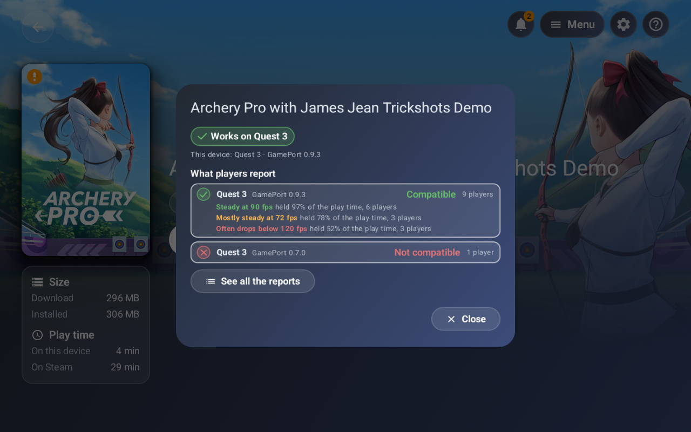
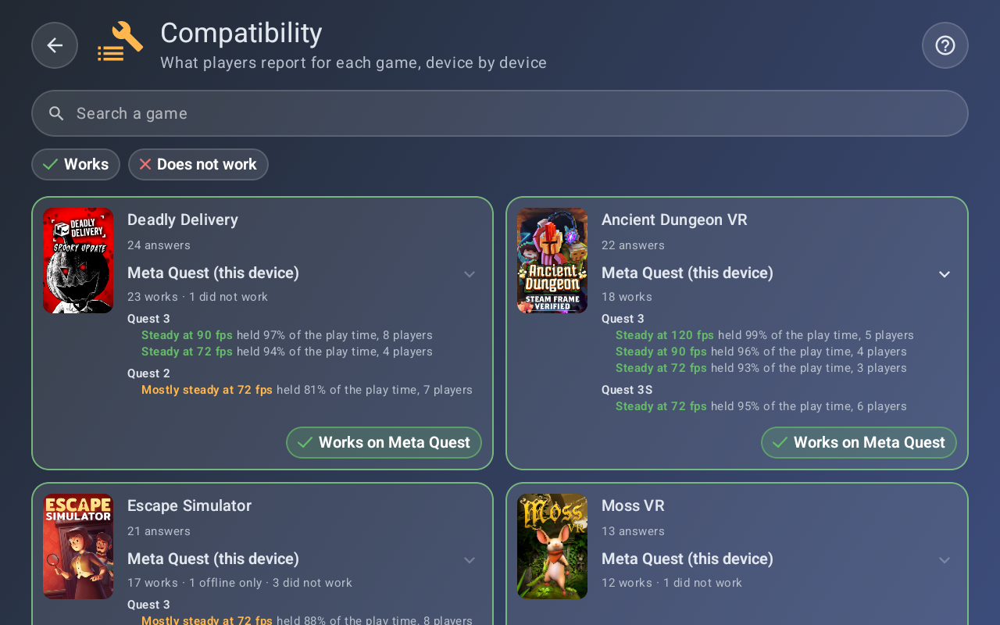

## GamePort 0.9.4

### What's new in this version

#### New features
- **Missing large files.** Installed games are checked for missing expansion files, and a card offers the repair first, with Play second. The check runs again after a crash or a failed answer.
- **Verdict by device.** The label of a game gives the answer for the exact model of the device, else for its kind of device, else for every device, and a button shows all the reports.
- **Smoothness by model and frame rate.** The details of a game tell how steadily it ran, for each device model and each frame rate, with the share of the play time that held it. The picture shows example values.

  
- **Smoothness on the compatibility page.** The same lines are on the page of compatibility, under each device model of each game. The picture shows example values.

  
- **Stronger reports.** A report tells what a game asks of Steam, how its run ended and where its frame rate stood. Tickets and account numbers are hidden, the raw crash dump is no longer attached, and a run under a minute is told apart, since it rarely shows the cause.

#### Fixes
- Unreal Engine 4 games, and games of any later Unreal version, get their VR entry.

---

### Install
The APK is `GamePort-v0.9.4.apk`, below. GamePort 0.9.3 offers it by itself, in Settings > Updates. On a Quest, developer mode is needed, with SideQuest or `adb install GamePort-v0.9.4.apk`. On a phone or a tablet, opening the file is enough.

It installs over 0.9.3 and keeps games, saves and settings. Games patched by an earlier version show an attention point, and GamePort offers to patch them again when it first opens.

GamePort is free and open source, and is not made by or affiliated with Valve, Meta or Pico. See the [README](https://github.com/gameport-project/gameport-app#readme).

---

## GamePort 0.9.4

### Les nouveautés de cette version

#### Nouvelles fonctionnalités
- **Gros fichiers manquants.** Les jeux installés sont vérifiés, et une carte propose d'abord la réparation, puis de jouer quand même. La vérification reprend après un plantage ou une réponse en échec.
- **Verdict par appareil.** L'étiquette d'un jeu donne la réponse pour le modèle exact de l'appareil, sinon pour son type d'appareil, sinon pour tous, et un bouton montre tous les rapports.
- **Fluidité par modèle et par fréquence.** Le détail d'un jeu dit si le jeu a tenu sa fréquence d'images, pour chaque modèle d'appareil et chaque fréquence, avec la part du temps de jeu où elle a été tenue. L'image montre des valeurs d'exemple.

  
- **Fluidité sur la page de compatibilité.** Les mêmes lignes sont sur la page de compatibilité, sous chaque modèle d'appareil de chaque jeu. L'image montre des valeurs d'exemple.

  
- **Rapports plus complets.** Un rapport dit ce que le jeu demande à Steam, comment sa partie s'est terminée et où en était sa fréquence d'images. Les tickets et les numéros de compte sont masqués, le vidage brut du plantage n'est plus joint, et une partie de moins d'une minute est signalée, car elle montre rarement la cause.

#### Corrections
- Les jeux Unreal Engine 4, et ceux de toute version d'Unreal suivante, reçoivent leur entrée VR.

---

### Installer
L'APK est `GamePort-v0.9.4.apk`, ci-dessous. GamePort 0.9.3 le propose toute seule, dans Réglages > Mises à jour. Sur un Quest, le mode développeur est nécessaire, avec SideQuest ou `adb install GamePort-v0.9.4.apk`. Sur un téléphone ou une tablette, ouvrir le fichier suffit.

Elle s'installe par-dessus la 0.9.3 et garde jeux, sauvegardes et réglages. Les jeux patchés par une version précédente affichent un point d'attention, et GamePort propose de les patcher de nouveau à sa première ouverture.

GamePort est gratuite et open source, et n'est ni créée par Valve, Meta ou Pico, ni affiliée à eux. Voir le [README](https://github.com/gameport-project/gameport-app/blob/main/README.fr.md).
