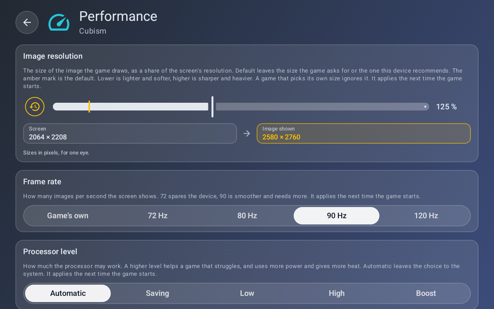

## GamePort 0.9.5

### What's new in this version

#### Pico
- **Pico's license check window no longer closes games.** Pico checks every game it knows against its store, and closes a few seconds after their start the ones that GamePort re-signed, without a line in any log. GamePort now installs a game under a name of GamePort's own on a Pico, so the check has nothing to compare it with and lets it run. New installs do it by themselves, and a game that is already installed and closes right after its start is offered the same install again by a card on its page. The saves of a game are sent to Steam before the old copy is removed, and the copy left behind is removed when GamePort comes to the front.
- **Installs lost when the device sleeps: fixed.** A Pico closes the confirmation window of Android when it goes to sleep, so an install waiting for it was lost. Games now install one at a time, the downloads page shows where each one is, and a button opens the confirmation again or gives the install up. The new copy of a game is written down before the old one is removed, and its saves are sent to Steam first.
- **Games that did not start on a Pico now start.** The per-view viewports of Unity that the graphics driver of a Pico 4 Ultra cannot take are turned off, the OpenXR permissions are given so the loader may read the runtime, Meta's plugin and the Pico's controllers work together, an Unreal game gets a stand-in for Unity's player class, and a patch no longer runs out of memory on a game with a large resource table.

#### New features
- **Performance page.** The page of a game sets the size of the image as a share of the screen's resolution, from 70 to 200 percent, with a mark on the default and the size in pixels, the frame rate, and the processor and graphics levels. Each choice applies the next time the game starts, and nothing is changed for a game left on its own.

  
- **The same message on a Quest, with the latest system.** On the latest version of Meta's system, some games meet a similar refusal: the Quest answers "This app is not approved for use" and the game never begins. The same install under a name of GamePort's own fixes them, but it is not done automatically on a Quest: it has to be turned on for those games, from the Compatibility options of the game, or from the card that now appears on its page when it closed before it began.
- **Higher frame rates.** A game that does not say which devices it is made for runs in compatibility mode on a Meta system, and is held to the lowest rate. When a higher frame rate is chosen, the game is patched to say so, and a button on the page patches it again when that is still to do. Without a choice, the game is left as it is.
- **Another app that sets the graphics.** When Quest Games Optimizer runs and knows a game by its name, or when system properties already set the graphics, the page says so and sends nothing to the game. A game installed under a name of GamePort's own is not known to it, and keeps the choices of the page.
- **Turn off what may close a game.** When a game closes on its own while choices of the Performance page are on, its page says which ones and a button turns them all off, patching the game again when GamePort had added the Quest declaration.
- **Installed version.** The page of a game shows the version of the installed game under its size, the one its APK carries and not the number the patches raise.
- **Downloads.** The number of games that download at once is a choice from 1 to 10, 2 by default.
- **Reports that say more.** A report gives the engine of the game and its settings, the measured frame rate, and which process and which launch each thing comes from. It also names the thread that asked for the end of a game that quit by itself, and a long run is no longer taken for a game that closed.
- **Small improvements.** A game that declares a system library the device lacks can still be installed. Access to all files is asked before an install when a game has files to place, and a Discord button is in the settings and the report windows. A game that may close on some devices is flagged, and a blocked game is shown only on the devices it concerns.
- **Last session.** The page of a game shows how the last session went: its duration, the time before the first image, the size of the image the game drew, the frame rate kept out of the one asked for, and the memory the game held with what the device still had free. The same figures sit at the top of the Performance page. After a slow session on a very large image, a note on the game's page suggests a lower resolution, which the player can close.
- **Libraries with a report.** The window of a report and the one that follows "it did not work" hold a box that adds the game's libraries to the report: how many files and about how much are shown, only the files listed go, and a Discord name is required. The libraries of the platform and of Steam come first, GamePort's own are never sent, and a game's page also has a button to send them alone. When they cannot go, the report goes without them.

#### Fixes
- The expansion files of an Unreal game keep the number each of them was built with (`patch.0` stays `patch.0`), and a file published without a number gets none, so games such as Red Matter 2 find their data under the name GamePort gives them.
- The downloads page stays at its top when the order of the games changes, and a report recognises Unreal Engine 4 games.
- The large files kept in sub-folders are counted, and the check looks again after a game is patched.
- A game installed under another name is taken as the game even when its record was left on the old name.
- A Unity game that wrote its own name in its data (Escape Simulator loads its texts from a folder named after it) follows the name GamePort installs it under: its menus no longer show bare keys, and an old copy of its code left by an earlier install is dropped when the game starts.
- A game that asks Steam for an encrypted app ticket now gets the real one, asked from Steam, instead of a made-up one, so the sign-in with mod.io works.
- A game flagged as one that may close, but not blocked, has its Play button inside the card that tells so, instead of above it.

---

### Install
The APK is `GamePort-v0.9.5.apk`, below. GamePort 0.9.4 offers it by itself, in Settings > Updates. On a Quest, developer mode is needed, with SideQuest or `adb install GamePort-v0.9.5.apk`. On a phone or a tablet, opening the file is enough.

It installs over 0.9.4 and keeps games, saves and settings. Games patched by an earlier version show an attention point, and GamePort offers to patch them again when it first opens.

GamePort is free and open source, and is not made by or affiliated with Valve, Meta or Pico. See the [README](https://github.com/gameport-project/gameport-app#readme).

---

## GamePort 0.9.5

### Les nouveautés de cette version

#### Pico
- **La fenêtre de vérification de licence de Pico ne ferme plus les jeux.** Pico compare chaque jeu qu'il connaît à son magasin, et ferme quelques secondes après leur démarrage ceux que GamePort a re-signés, sans une ligne dans aucun journal. GamePort installe maintenant un jeu sous un nom propre à GamePort sur un Pico, si bien que la vérification n'a rien à comparer et le laisse tourner. Les nouvelles installations le font toutes seules, et un jeu déjà installé qui se ferme juste après son démarrage se voit proposer la même installation par une carte de sa page. Les sauvegardes d'un jeu sont envoyées à Steam avant que l'ancienne copie soit retirée, et la copie laissée derrière est retirée quand GamePort revient au premier plan.
- **Les installations perdues quand l'appareil passe en veille : réglé.** Un Pico ferme la fenêtre de confirmation d'Android quand il passe en veille, et une installation qui l'attendait était perdue. Les jeux s'installent maintenant un par un, la page des téléchargements montre où en est chacun, et un bouton rouvre la confirmation ou abandonne l'installation. La nouvelle copie d'un jeu est notée avant que l'ancienne soit retirée, et ses sauvegardes sont envoyées à Steam d'abord.
- **Des jeux qui ne démarraient pas sur Pico démarrent maintenant.** Les fenêtres par vue d'Unity que le pilote graphique d'un Pico 4 Ultra ne supporte pas sont désactivées, les permissions OpenXR sont données pour que le chargeur lise le runtime, le plugin de Meta et les manettes du Pico fonctionnent ensemble, un jeu Unreal reçoit un substitut de la classe de lecteur d'Unity, et un patch ne manque plus de mémoire sur un jeu à grande table de ressources.

#### Nouvelles fonctionnalités
- **Page Performance.** La page d'un jeu règle la taille de l'image en proportion de la résolution de l'écran, de 70 à 200 %, avec un repère sur la valeur par défaut et la taille en pixels, la fréquence d'images, et les niveaux du processeur et du processeur graphique. Chaque choix s'applique au prochain démarrage du jeu, et rien ne change pour un jeu laissé tel quel.

  
- **Le même message sur Quest, avec le dernier système.** Sur la dernière version du système de Meta, certains jeux rencontrent un refus semblable : le Quest répond « Cette application n'est pas approuvée pour être utilisée » et le jeu ne commence jamais. La même installation sous un nom propre à GamePort les répare, mais elle n'est pas faite automatiquement sur Quest : il faut l'activer pour ces jeux, depuis les options de compatibilité du jeu, ou depuis la carte qui apparaît maintenant sur sa page quand il s'est fermé avant d'avoir commencé.
- **Fréquences plus hautes.** Un jeu qui ne dit pas pour quels appareils il est fait tourne en mode de compatibilité sur un système Meta, et reste limité à la fréquence la plus basse. Quand une fréquence plus haute est choisie, le jeu est patché pour le dire, et un bouton de la page le patche de nouveau quand cela reste à faire. Sans choix, le jeu reste tel quel.
- **Une autre application qui règle les graphismes.** Quand Quest Games Optimizer tourne et connaît un jeu par son nom, ou que des propriétés du système règlent déjà les graphismes, la page le dit et n'envoie rien au jeu. Un jeu installé sous un nom propre à GamePort ne lui est pas connu, et garde les choix de la page.
- **Désactiver ce qui peut fermer un jeu.** Quand un jeu se ferme tout seul alors que des choix de la page Performance sont activés, sa page dit lesquels et un bouton les désactive tous, en patchant de nouveau le jeu si GamePort y avait ajouté la déclaration pour Quest.
- **Version installée.** La page d'un jeu montre la version du jeu installé sous sa taille, celle que porte son APK et non le numéro que les patchs augmentent.
- **Téléchargements.** Le nombre de jeux qui téléchargent en même temps se choisit de 1 à 10, 2 par défaut.
- **Des rapports plus parlants.** Un rapport donne le moteur du jeu et ses réglages, la fréquence d'images mesurée, et de quel processus et de quel lancement vient chaque chose. Il indique aussi quel thread a demandé la fin d'un jeu qui s'est fermé tout seul, et une longue partie n'est plus prise pour celle d'un jeu qui s'est fermé.
- **Petites améliorations.** Un jeu qui déclare une bibliothèque système absente de l'appareil peut quand même s'installer. L'accès à tous les fichiers est demandé avant l'installation quand un jeu a des fichiers à placer, et un bouton Discord figure dans les réglages et dans les fenêtres de rapport. Un jeu qui peut se fermer sur certains appareils est signalé, et un jeu bloqué n'apparaît que sur les appareils concernés.
- **Dernière session.** La page d'un jeu montre comment s'est passée la dernière session : sa durée, le temps avant la première image, la taille de l'image dessinée par le jeu, la fréquence d'images tenue sur celle demandée, et la mémoire utilisée par le jeu avec ce qu'il restait de libre sur l'appareil. Les mêmes chiffres figurent en haut de la page Performance. Après une session lente avec une très grande image, une note sur la page du jeu suggère une résolution plus basse, que le joueur peut fermer.
- **Les bibliothèques avec un rapport.** La fenêtre d'un rapport et celle qui suit « ça ne marche pas » portent une case qui ajoute les bibliothèques du jeu au rapport : le nombre de fichiers et leur taille approximative sont montrés, seuls les fichiers listés partent, et un pseudo Discord est obligatoire. Les bibliothèques de la plateforme et de Steam passent en premier, celles de GamePort ne sont jamais envoyées, et la page d'un jeu a aussi un bouton pour les envoyer seules. Quand elles ne peuvent pas partir, le rapport part sans elles.

#### Corrections
- Les fichiers d'extension d'un jeu Unreal gardent le numéro avec lequel chacun a été construit (`patch.0` reste `patch.0`), et un fichier publié sans numéro n'en reçoit pas, si bien que des jeux comme Red Matter 2 retrouvent leurs données sous le nom que GamePort leur donne.
- La page des téléchargements reste en haut quand l'ordre des jeux change, et un rapport reconnaît les jeux Unreal Engine 4.
- Les gros fichiers rangés dans des sous-dossiers sont comptés, et la vérification reprend après le patch d'un jeu.
- Un jeu installé sous un autre nom est pris pour le jeu même quand son enregistrement était resté sur l'ancien nom.
- Un jeu Unity qui a écrit son propre nom dans ses données (Escape Simulator charge ses textes depuis un dossier qui porte son nom) suit le nom sous lequel GamePort l'installe : ses menus ne montrent plus de clés brutes, et une ancienne copie de son code laissée par une installation précédente est écartée au démarrage du jeu.
- Un jeu qui demande à Steam un ticket d'application chiffré reçoit maintenant le vrai, demandé à Steam, au lieu d'un ticket fabriqué, si bien que la connexion à mod.io fonctionne.
- Un jeu signalé comme pouvant se fermer, mais non bloqué, a son bouton Jouer dans la carte qui le dit, au lieu d'au-dessus.

---

### Installer
L'APK est `GamePort-v0.9.5.apk`, ci-dessous. GamePort 0.9.4 le propose toute seule, dans Réglages > Mises à jour. Sur un Quest, le mode développeur est nécessaire, avec SideQuest ou `adb install GamePort-v0.9.5.apk`. Sur un téléphone ou une tablette, ouvrir le fichier suffit.

Elle s'installe par-dessus la 0.9.4 et garde jeux, sauvegardes et réglages. Les jeux patchés par une version précédente affichent un point d'attention, et GamePort propose de les patcher de nouveau à sa première ouverture.

GamePort est gratuite et open source, et n'est ni créée par Valve, Meta ou Pico, ni affiliée à eux. Voir le [README](https://github.com/gameport-project/gameport-app/blob/main/README.fr.md).
